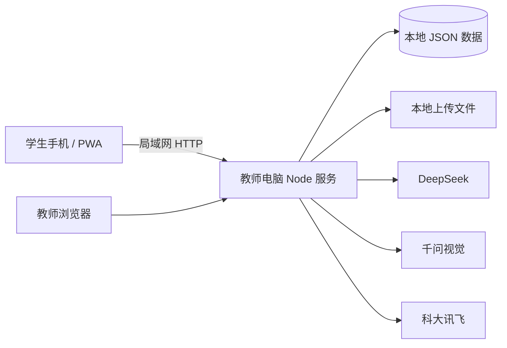

# 知行 · AI 教学诊断

一个面向公开课与日常教学的本地优先 AI 助教。教师电脑运行前后端与 AI 代理，学生手机通过局域网浏览器加入课堂；API Key 永远不会发送到学生端。

当前版本已经跑通以下闭环：

**课程 / 知识点 / 资料 → AI 出题与教师确认 → 发布课堂 → 手机作答 / 拍照 → 判题与诊断 → 班级报告 / 学生画像 → 强化练习 → 教师 AI 助教**

## 已实现功能

教师端：

- 创建课程，管理可配置的知识点、公式与概念；
- 上传 TXT、Markdown、CSV、JSON、PDF、DOCX 资料并提取文本；
- 按知识点、题型、数量、难度和来源生成题目；
- 预览、修改、确认 AI 题目；
- 已保留 `QuestionBankProvider` 题库适配接口，可接校本或第三方题库；
- 创建、发布和结束课堂，展示课堂码与二维码；
- 查看正确率、得分分布、知识点掌握、逐题表现和错误类型；
- 查看学生的知识点、能力维度、历史成绩和个性化总结；
- 基于当前课堂真实数据与 AI 助教对话；
- 支持浏览器语音识别，以及配置讯飞后的后端流式语音听写。

学生端：

- 手机输入课堂码或扫描二维码加入；
- 完成单选、多选、判断、填空和解答题；
- 拍照上传手写答案与计算过程；
- 查看得分、错误位置、原因、错误类型、相关概念和提高建议；
- 针对薄弱知识点生成相似题、公式默写或概念回忆练习；
- 支持 PWA 安装到手机桌面。

未配置 AI Key 时，系统自动使用演示出题、启发式主观题评分和数据驱动建议，所有页面与流程仍可体验。仓库首次启动会生成一次函数示例课程，课堂码为 `MATH8`。

## 架构



- 前端：React + TypeScript + Vite + Recharts；
- 后端：Express + TypeScript；
- 数据：教师电脑上的 `data/db.json`；
- 文件：教师电脑上的 `uploads/`；
- PWA：Workbox 自动生成 Service Worker；
- AI：三个彼此独立的服务适配器，便于更换供应商。

`data/`、`uploads/`、`.env` 均已加入 `.gitignore`。

## 快速开始

### 环境要求

- Node.js 20 或更高版本；
- pnpm 10 或更高版本；
- Windows 10/11、macOS 或 Linux。

安装 pnpm：

```bash
npm install -g pnpm
```

### 开发模式

```bash
pnpm install
pnpm dev
```

- 教师端：<http://localhost:5173/teacher>
- 学生端：<http://localhost:5173/join>
- 开发模式 API 服务：<http://localhost:4173/api/health>

### 公开课 / 生产模式

```bash
pnpm install
pnpm build
pnpm start
```

也可以在 Windows 中双击 `start.bat`。生产模式统一访问：

- 教师端：<http://localhost:4173/teacher>
- 学生端：`http://教师电脑局域网IP:4173/join`

启动日志会列出可用的局域网地址。教师端“课堂检测”页面会为每次课堂生成二维码。

### 让学生手机访问

1. 教师电脑与学生手机连接同一个 Wi-Fi；
2. 运行生产模式；
3. 若 Windows 防火墙弹窗出现，允许 Node.js 在“专用网络”通信；
4. 在教师端发布课堂并投屏二维码；
5. 手机扫码或访问 `http://教师电脑IP:4173/join`。

校园网若启用了 AP 隔离，手机可能无法访问同一 Wi-Fi 下的电脑。此时请改用教师自建热点、便携路由器，或让网络管理员关闭该网络的客户端隔离。

## AI 配置

复制环境变量模板：

```powershell
Copy-Item .env.example .env
```

macOS / Linux：

```bash
cp .env.example .env
```

然后只在教师电脑的 `.env` 中填写密钥。修改后重启服务。

### 1. DeepSeek：出题、主观题评分、诊断与教师助教

```env
DEEPSEEK_API_KEY=你的密钥
DEEPSEEK_BASE_URL=https://api.deepseek.com
DEEPSEEK_MODEL=deepseek-v4-flash
```

截至 2026-08-11，官方已停用旧别名 `deepseek-chat` / `deepseek-reasoner`，当前接口使用 `deepseek-v4-flash` 或 `deepseek-v4-pro`。后续如模型更新，以 [DeepSeek 模型列表](https://api-docs.deepseek.com/api/list-models) 为准。

注册并配置：

1. 打开 [DeepSeek 开放平台](https://platform.deepseek.com/) 注册并完成账户设置；
2. 在平台创建 API Key；
3. 将 Key 写入教师电脑 `.env`；
4. 重启服务，教师总览会从“演示模式”切换为“AI 服务已连接”。

接口采用官方 [Chat Completions](https://api-docs.deepseek.com/api/create-chat-completion)。

### 2. 阿里云百炼 / 千问视觉：手写与公式识别

```env
DASHSCOPE_API_KEY=你的百炼API Key
QWEN_VL_BASE_URL=https://你的WorkspaceId.cn-beijing.maas.aliyuncs.com/compatible-mode/v1
QWEN_VL_MODEL=qwen-vl-plus
```

注册并配置：

1. 注册阿里云并开通 [大模型服务平台百炼](https://bailian.console.aliyun.com/)；
2. 选择与部署位置一致的地域和业务空间；
3. 在 API Key 页面创建 Key，并立即保存弹窗中显示的 API Key 与 API Host；
4. 将 API Host 原样填写到 `QWEN_VL_BASE_URL`，不要照抄其他地域的地址；
5. 将 Key 与模型名写入 `.env` 后重启。

百炼的新 Key 可能以 `sk-ws` 开头，明文只在创建时显示一次。参见阿里云官方的 [获取 API Key](https://help.aliyun.com/zh/model-studio/get-api-key/) 与 [OpenAI 兼容接口](https://help.aliyun.com/zh/model-studio/qwen-api-via-openai-chat-completions)。

### 3. 科大讯飞：教师语音转文字

```env
XFYUN_APP_ID=你的AppID
XFYUN_API_KEY=你的APIKey
XFYUN_API_SECRET=你的APISecret
```

注册并配置：

1. 注册 [讯飞开放平台](https://www.xfyun.cn/)；
2. 创建应用并添加“语音听写（流式版）”服务；
3. 在应用的服务页面获取 AppID、APIKey、APISecret；
4. 写入 `.env` 并重启；
5. 教师助教页点击麦克风开始录音，再次点击后发送识别与提问。

本项目按官方要求上传 16 kHz、16 bit、单声道 PCM，并由教师后端生成 HMAC-SHA256 签名连接 `wss://iat-api.xfyun.cn/v2/iat`。详见 [讯飞语音听写流式 WebAPI](https://www.xfyun.cn/doc/asr/voicedictation/API.html)。未配置讯飞时，页面会回退到 Chrome / Edge 自带的中文语音识别。

## 题库接口

题库逻辑位于 `server/questionBank.ts`：

```ts
export interface QuestionBankProvider {
  search(config: GenerateConfig): Promise<Question[]>
}
```

将 `EmptyQuestionBank` 替换为校本题库或第三方题库实现即可。页面已经支持“仅题库”和“混合模式”；混合模式会优先使用题库，不足部分再由 AI 生成。

## 数据与判题原则

- 单选、多选、判断和可精确匹配的填空题优先程序判题；
- 主观题才调用 DeepSeek，失败时回退到启发式评分；
- 图片先由千问视觉提取原始作答，再进入判题与诊断；
- 班级正确率、掌握度、分布和趋势均由真实得分计算；
- AI 只负责解释、总结和建议，不直接虚构统计数字；
- 学生端接口不会返回参考答案，提交完成后才返回评分反馈。

## 测试与构建

```bash
pnpm check   # 前后端 TypeScript 检查
pnpm test    # 判题、报告与画像核心测试
pnpm build   # 生产构建 + PWA
```

项目已在 Windows 上验证生产启动、学生加入、提交判题、报告更新，以及 390×844 手机断点。

## 当前边界与后续建议

- 当前数据层为适合单机公开课的原子写入 JSON；多人长期正式使用时建议迁移到 SQLite 或 PostgreSQL；
- 当前没有教师账号登录，默认运行环境是可信教师电脑与受控局域网；
- 资料采用文本提取后直接作为课程上下文。资料较多时建议增加切片、向量检索和引用溯源；
- 已有 PWA 缓存，但答题提交仍需要连接教师电脑；
- 若要公网部署，需要增加 HTTPS、身份认证、数据库备份、限流与对象存储。

## GitHub 托管

本项目适合把**源码**托管到 GitHub，课堂服务仍运行在教师电脑上。不要把 `.env`、`data/` 或 `uploads/` 提交到仓库。

```bash
git init
git add .
git commit -m "feat: build AI teaching diagnosis MVP"
gh repo create classinsight-ai --private --source . --remote origin --push
```

如果需要团队协作，可将仓库设为私有并邀请其他教师或开发者。由于该系统包含后端、文件上传和本地持久化，不适合直接部署到 GitHub Pages。
