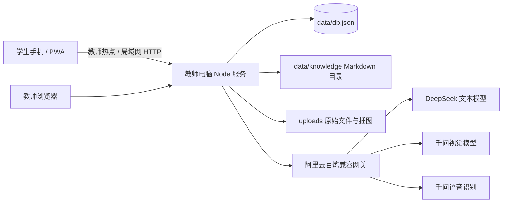

# 知行 · AI 教学诊断

一个面向公开课和日常教学的本地优先 AI 助教。教师电脑运行前端、后端、资料库与 AI 代理；学生手机连接教师热点后打开固定入口，自动进入当前检测。API Key 永远不会发送到学生端。

核心闭环：

**课程 / 知识点 / 资料 → AI 出题与教师确认 → 发布检测 → 手机作答 / 拍照 → 判题与诊断 → 班级报告 / 学生画像 → 强化练习 → 教师 AI 助教**

## 当前能力

- 教师端：课程、知识点、PDF/PPTX/DOCX/图片资料、AI 出题、题库接口、检测发布、逐题与班级报告、学生画像、语音 AI 助教。
- 学生端：连接教师热点后自动进入唯一活动检测；支持客观题、文字和拍照作答；返回评分、错误原因、相关公式与强化练习。
- 资料入库：原生提取文本，抽取 Office 插图，扫描型 PDF/图片按需调用百炼视觉；输出带来源的 Markdown 知识目录。
- AI 问答：按问题检索课程、知识点、题库、课堂、作答和画像文件，减少无关上下文与 Token；回答要求标注来源。
- Markdown：支持 GFM 表格、列表、代码、KaTeX 公式和本地资料插图，并经过安全清洗。
- PWA：学生入口可安装到手机桌面，之后连上教师热点并打开 PWA 即可自动进入当前检测。

未配置 AI Key 时，演示出题、启发式主观题评分和数据驱动建议仍可完整运行。首次启动会生成一次函数示例数据。

## 架构



- React + TypeScript + Vite + Recharts；
- Express + TypeScript；
- 单机 JSON 原子写入，适合公开课和小规模使用；
- 百炼服务适配按文本、视觉、语音三个模块保持独立，当前共用一个 Key 与兼容网关。

`data/`、`uploads/`、`.env` 不会提交到 Git。

## 安装与运行

要求 Node.js 20+ 和 pnpm 10+。

```bash
pnpm install
pnpm dev
```

- 开发教师端：<http://localhost:5173/teacher>
- 开发学生端：<http://localhost:5173/join>
- API：<http://localhost:4173/api/health>

公开课使用生产模式：

```bash
pnpm build
pnpm start
```

Windows 也可双击 `start.bat`。生产模式教师端为 <http://localhost:4173/teacher>。

## Windows 热点与学生自动入课

1. 教师端进入“课堂检测”，发布一个检测；新检测发布时会自动结束上一个活动检测。
2. 点击“热点入课” → “打开热点设置”，在 Windows 中开启移动热点。
3. 把系统显示的热点名称、密码填回页面，选择学生访问地址并保存。Windows 热点常见地址是 `http://192.168.137.1:4173`，但应以页面检测结果为准。
4. 投屏热点 Wi-Fi 二维码，学生扫码连接。
5. 学生打开已安装的“知行课堂”PWA，或访问页面显示的固定 `/join` 地址。系统自动读取唯一活动检测，不输入课堂码、不选择课程。

手机系统不允许 Wi-Fi 二维码在连网后替网页静默启动浏览器，所以“扫码”负责连热点，“打开 PWA/固定地址”由系统安全策略要求。首次访问建议把学生端添加到桌面。Windows 防火墙弹窗出现时需允许 Node.js 在“专用网络”通信。

## 百炼 AI 配置

复制模板：

```powershell
Copy-Item .env.example .env
```

在教师电脑 `.env` 中填写：

```env
DASHSCOPE_API_KEY=你的百炼APIKey
BAILIAN_BASE_URL=https://dashscope.aliyuncs.com/compatible-mode/v1
BAILIAN_TEXT_MODEL=deepseek-v4-flash
BAILIAN_VISION_MODEL=qwen3-vl-flash
BAILIAN_ASR_MODEL=qwen3-asr-flash
MATERIAL_VISION_MODE=smart
MATERIAL_VISION_MAX_IMAGES=4
```

如果百炼控制台给出带业务空间 ID 的专属兼容地址，应把 `BAILIAN_BASE_URL` 替换成控制台地址。修改配置后重启服务。

资料视觉默认是节省 Token 的 `smart`：Office 直接解析 XML/正文和媒体，文本型 PDF 不逐页调用模型；仅扫描 PDF、纯图片和正文稀疏的 Office 资料自动视觉识别，单份默认最多 4 张。临时关闭可设为 `off`，确需完整视觉处理再设为 `full` 并提高上限。

截至 2026-08-11，本项目按百炼 OpenAI 兼容接口接入：

- DeepSeek 负责出题、主观题评分、诊断、画像和教师问答。模型可按额度和延迟在 `deepseek-v4-flash` / `deepseek-v4-pro` 间切换，参见[百炼 DeepSeek API](https://help.aliyun.com/en/model-studio/deepseek-api)。
- `qwen3-vl-flash` 负责手写答案、公式、扫描页和资料插图提取；需要更高精度时可改为可用的 Plus 视觉模型，参见[百炼视觉理解](https://help.aliyun.com/zh/model-studio/vision/)。
- `qwen3-asr-flash` 负责教师中文语音转文字，前端上传 16 kHz 单声道 WAV，参见[Qwen ASR API](https://help.aliyun.com/en/model-studio/qwen-asr-api-reference)。

注册流程：登录[阿里云百炼控制台](https://bailian.console.aliyun.com/)，开通模型服务并创建 API Key；确认所选地域、业务空间和模型额度；把 Key 与对应兼容地址写入 `.env`。不要把真实 Key 放入源码或 Git。

## 课程资料与知识目录

上传资料后会生成：

```text
data/knowledge/<course-id>/
├── 00-course.md
├── 01-knowledge-points/
├── 02-materials/
├── 03-question-bank/
├── 04-classrooms/<assessment-id>/
│   ├── overview.md
│   ├── report.md
│   └── submissions/<student-id>.md
├── 05-students/
└── manifest.json
```

教师助教先检索 `manifest.json`，只读取与问题最相关的少量文件。全局约束在 `prompts/teacher-assistant.md`，资料处理规范在 `skills/course-material-ingestion/`。

默认解析器保持轻量，借鉴了 [MinerU](https://github.com/opendatalab/MinerU) 的“LLM-ready Markdown/JSON、公式与图片保留”思路和 [Docling](https://github.com/docling-project/docling) 的“统一文档结构、直接解析 + OCR 混合路线”。复杂科学 PDF 可在以后把它们接为增强解析器，不影响当前单机运行。

## Markdown 与安全

页面使用 `react-markdown`、GFM、`remark-math` 和 KaTeX。原始 HTML 不执行，并通过 `rehype-sanitize` 清洗；资料图片只从安全 URL 渲染。模型提示要求公式使用 `$...$` 或 `$$...$$`，文件图片引用已有 `/uploads/...` 地址。

## 题库接口

`server/questionBank.ts` 提供 `QuestionBankProvider`。页面已保留“仅题库”和“混合模式”；接入校本题库时替换当前空实现即可。

## 测试

```bash
pnpm check
pnpm test
pnpm build
```

正式多人长期使用前建议把 JSON 迁移到 SQLite/PostgreSQL，并加入教师登录、备份、限流和学生身份合并。

## GitHub

源码托管于 <https://github.com/farlater/zhixing-ai-teaching-assistant>。课堂服务仍运行在教师电脑，GitHub Pages 不能代替本地后端。
