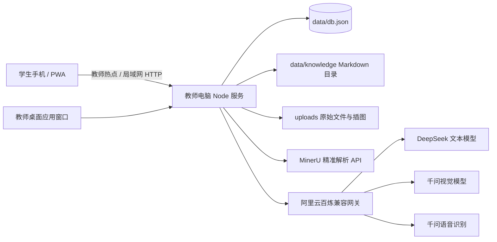

# 知行 · AI 教学诊断

一个面向教学展示和日常教学的本地优先 AI 助教。教师电脑运行前端、后端、资料库与 AI 代理；学生手机连接教师热点后，用 APK 扫描课堂二维码，自动取得教师电脑地址、端口和当前检测。API Key 永远不会发送到学生端。

核心闭环：

**课程 / 知识点 / 资料 → AI 出题与教师确认 → 发布课堂检测 / 课后作业 → 手机作答 / 拍照 → 判题与诊断 → 分类报告 / 学生画像 → 讲解视频 / 强化练习 → 教师 AI 助教**

## 当前能力

- 教师端：课程、知识点、PDF/PPTX/DOCX/图片资料、AI 出题、题库接口、检测发布、逐题与班级报告、学生画像、语音 AI 助教。
- 课程题库：既可直接录入单题，也可上传 PDF、PPT/PPTX、DOC/DOCX 或图片批量导入。系统先由 MinerU 保留版面、公式和题图，再由百炼模型识别题型并拆成逐题草稿，教师预览勾选后才进入正式题库。题目生成页可选择题库原题，或让 AI 只修改数值并重新计算答案。
- 学生端：连接教师热点后扫描课堂二维码，填写班级、姓名进入；支持客观题、文字和拍照作答；返回评分、错误原因、相关公式与强化练习。
- 资料入库：MinerU 官方 API 解析 PDF、Office、扫描件、公式、表格与版面；输出 Markdown、结构化 JSON 和独立图片，再对缺少图意的插图选择性调用百炼视觉。
- AI 问答：按问题检索课程、知识点、题库、课堂、作答和画像文件，减少无关上下文与 Token；回答要求标注来源。
- Markdown：支持 GFM 表格、列表、代码、KaTeX 公式和本地资料插图，并经过安全清洗。
- PWA：课堂二维码也可由手机浏览器直接打开对应检测。

首次启动预置三节大学《机械原理》课程、知识点、9 道图示客观题、1 道拍照作答综合题，以及机械2301班 60 名学生的 12 次课堂检测和 12 次课后作业展示成绩。历史任务每次为 8–12 道题，学生能力采用连续分布，并叠加任务难度、个体波动和缓慢进步，避免成绩集中在少数离散分数段。课堂与作业报告分开；学生综合成绩按课堂 30% + 作业 70% 计算并排名。统计图表根据数据库作答实时计算；AI 文字诊断使用缓存，只有教师点击“更新诊断”才重新调用百炼。

## 当前预置内容

- 当前按三节不同课程展示：`平面四杆机构的急回特性`、`定轴轮系的传动比`、`平面机构的组成与结构分析`；此前重复提供的第二份“四杆机构”文件不再作为第三节课；
- 三节课内置 9 道图示客观题；“平面机构的组成与结构分析”课程另含 1 道 16 分拍照综合解答题，与选择题处于同一题库和同一次检测中。综合题来自江苏大学 803《机械原理》官方样题 A 卷第 2 题；
- 创建教学任务时可选统一试卷、题库随机或 AI 变式题池。题库随机由教师后端按学生稳定分配同题型题目；当前演示记录默认使用统一试卷；
- 课程资料可为知识点关联讲解视频。视频内容不送入 AI；学生答错后可从诊断页进入，完整播放前不能快进，也不能提交学习记录；
- 学生路径：连接热点 → APK 扫描当前课堂二维码 → 填写班级、姓名 → 完成 4 题（最后一题可拍照）→ 查看逐题诊断；
- 教师报告预置 60 人展示数据，新增学生提交后统计自动更新。AI 诊断不会随每次提交消耗 Token，需由教师点击“更新诊断”手动刷新。

## 架构



- React + TypeScript + Vite + Recharts；
- Express + TypeScript；
- 单机 JSON 原子写入，适合公开课和小规模使用；
- 百炼服务适配按文本、视觉、语音三个模块保持独立，当前共用一个 Key 与兼容网关。

`data/`、`uploads/`、`.env` 不会提交到 Git。

## 安装与运行

教师电脑使用下面的一键安装时，无需预装 Node.js 或 pnpm。

### Windows 一键安装（教师电脑推荐）

直接双击项目根目录的 `安装知行AI助教.bat`。安装程序会：

1. 下载并校验官方 Node.js LTS 便携运行时，不使用电脑中已有的 Node 环境；
2. 安装依赖并构建生产版本；
3. 安装到 `%LOCALAPPDATA%\Programs\ZhixingAI`；
4. 创建桌面“知行 AI 教学诊断”快捷方式；
5. 请求一次 Windows 管理员授权，为专用网络开放 TCP 4173；
6. 启动服务并打开教师端。

首次使用需要联网下载运行环境和依赖。以后双击桌面图标即可启动，不需要打开命令行。Windows 版优先以 Edge 应用模式打开独立教师窗口（无地址栏和标签页），没有 Edge 时才退回默认浏览器。开始菜单同时提供“配置 AI 服务”“停止本地服务”和“卸载”入口。重新安装或升级时会保留原有 `data`、`uploads` 和 `.env`。

GitHub Actions 的 `Build Windows installer` 工作流还会生成包含 Node 运行时和生产依赖的 `.exe` 一键安装包及便携版 ZIP。下载 `.exe` 后安装不再需要 Node.js 或 pnpm；便携版解压后双击 `Start-Zhixing.bat` 即可。未签名的测试版可能显示 Windows SmartScreen 提示。

### 学生端 Android APK

`student-android/` 是独立的轻量 Android 客户端。APK 打开后显示“扫码加入课堂”，扫描教师端二维码后自动保存教师电脑 IP、端口与检测 ID，再加载学生页面；扫描或连接失败时才显示手动地址设置。APK 不包含后端、课程数据或 AI Key，因此教师端更新题目和页面后无需重新发布 APK。

APK 支持填写班级姓名、答题、诊断，以及从相册选择或直接拍摄手写答案。教师端始终只有一个活动检测，二维码也会指定该检测。`Build student Android APK` 工作流会生成可直接安装的 APK。当前自动产物使用 Android debug 签名，适合内部使用；正式长期分发前应配置固定 release keystore。

### 开发方式

源码开发要求 Node.js 20+ 和 pnpm 10+。

```bash
pnpm install
pnpm dev
```

- 开发教师端：<http://localhost:5173/teacher>
- 开发学生端：<http://localhost:5173/join>
- API：<http://localhost:4173/api/health>

公开课使用生产模式：

```bash
pnpm build
pnpm start
```

Windows 也可双击 `start.bat`。生产模式教师端为 <http://localhost:4173/teacher>。

## Windows 热点与学生扫码入课

1. 教师端进入“教学任务”，在“课堂检测”或“课后作业”分区发布任务；新任务发布时会自动结束上一个活动任务。
2. 学生在手机 Wi-Fi 设置中手动连接教师电脑热点。
3. 教师点击“显示二维码”。系统固定使用 Windows 移动热点地址 `http://192.168.137.1:4173`，避免误选家庭 Wi-Fi、VPN 或虚拟网卡。
4. 学生打开 APK，点击“扫码加入课堂”并扫描教师端二维码。二维码格式为 `http://教师电脑IP:4173/join?assessment=检测ID`。
5. APK 自动保存地址、端口和课堂，学生只需填写班级、姓名。手机浏览器扫描同一二维码也可直接打开 PWA。

二维码不包含 Wi-Fi 名称或密码，也不负责连接热点。Windows 防火墙弹窗出现时需允许 Node.js 在“专用网络”通信。

当前 Windows 教师端的课堂二维码固定使用 `http://192.168.137.1:4173`，不会再列出家庭 Wi-Fi、VPN 或虚拟网卡地址。学生必须先连接教师电脑的 Windows 移动热点，再扫码进入。

学生提交包含解答题时，服务器会先保存作答和规则诊断，再在后台完成 DeepSeek 评分；手机页面轮询最终结果，因此不会因为模型耗时而让一次提交请求长时间挂起。后台阶段与耗时记录在安装目录 `app/data/logs/server-output.log`，异常记录在 `server-error.log`。

## MinerU 与百炼配置

复制模板：

```powershell
Copy-Item .env.example .env
```

在教师电脑 `.env` 中填写：

```env
DASHSCOPE_API_KEY=你的百炼APIKey
BAILIAN_BASE_URL=https://dashscope.aliyuncs.com/compatible-mode/v1
BAILIAN_TEXT_MODEL=deepseek-v4-flash
BAILIAN_VISION_MODEL=qwen3-vl-flash
BAILIAN_ASR_MODEL=qwen3-asr-flash
MINERU_API_TOKEN=你的MinerU Token
MINERU_API_BASE=https://mineru.net/api/v4
MINERU_MODEL_VERSION=vlm
MINERU_ENABLE_OCR=true
MATERIAL_IMAGE_ENRICHMENT=smart
MATERIAL_VISION_MODE=smart
```

也可以在教师端右上角点击齿轮图标，直接填写百炼 API Key 和 MinerU Token；密钥不会回显，并且只允许教师电脑本机修改。保存后立即生效。若使用 `.env` 手工修改，则重启服务。

如果百炼控制台给出带业务空间 ID 的专属兼容地址，应把 `BAILIAN_BASE_URL` 替换成控制台地址。

在 [MinerU API 管理页](https://mineru.net/apiManage/token) 申请 Token 后写入教师电脑 `.env`。Token 只在 Node 后端使用，不会下发给学生。当前使用精准解析 API 的 `vlm` 模型：本地文件先申请签名上传地址，上传后后台轮询，完成时下载结果 ZIP。单文件按官方限制为 200 MB、600 页；教师页面会自动刷新解析状态。

MinerU 负责扫描页 OCR、阅读顺序、公式 LaTeX、表格结构和图片裁切。结果包中的 `full.md` 会写入课程知识目录，原始 Markdown、`content_list.json`、`middle/model` 等 JSON 保存在 `data/mineru/<material-id>/`，图片保存在 `uploads/materials/<material-id>/`。系统检查内容列表后，只把没有语义 `content` 的插图/图表交给百炼视觉补充，不重复识别扫描正文、公式或表格。`MATERIAL_IMAGE_ENRICHMENT=smart` 为默认策略，`off` 完全关闭补充识别，`full` 识别全部提取图片；均不设单份图片数量上限。

未配置 MinerU Token 时，TXT/Markdown/CSV/JSON 始终可本地直接读取，PDF/PPTX/DOCX/图片仍保留轻量兼容解析；此时 `MATERIAL_VISION_MODE` 控制兼容路径的百炼视觉策略。正式课堂资料建议配置 MinerU，以免复杂版式退化。

截至 2026-08-11，本项目按百炼 OpenAI 兼容接口接入：

- DeepSeek 负责出题、主观题评分、诊断、画像和教师问答。模型可按额度和延迟在 `deepseek-v4-flash` / `deepseek-v4-pro` 间切换，参见[百炼 DeepSeek API](https://help.aliyun.com/en/model-studio/deepseek-api)。
- `qwen3-vl-flash` 负责学生手写答案，以及 MinerU 未提供图意文本的课程插图补充；需要更高精度时可改为可用的 Plus 视觉模型，参见[百炼视觉理解](https://help.aliyun.com/zh/model-studio/vision/)。
- `qwen3-asr-flash` 负责教师中文语音转文字，前端上传 16 kHz 单声道 WAV，参见[Qwen ASR API](https://help.aliyun.com/en/model-studio/qwen-asr-api-reference)。

注册流程：登录[阿里云百炼控制台](https://bailian.console.aliyun.com/)，开通模型服务并创建 API Key；确认所选地域、业务空间和模型额度；把 Key 与对应兼容地址写入 `.env`。不要把真实 Key 放入源码或 Git。

## 课程资料与知识目录

上传资料后会生成：

```text
data/knowledge/<course-id>/
├── 00-course.md
├── 01-knowledge-points/
├── 02-materials/
├── 03-question-bank/
├── 04-classrooms/<assessment-id>/
│   ├── overview.md
│   ├── report.md
│   └── submissions/<student-id>.md
├── 05-students/
└── manifest.json
```

教师助教先检索 `manifest.json`，只读取与问题最相关的少量文件。全局约束在 `prompts/teacher-assistant.md`，资料处理规范在 `skills/course-material-ingestion/`。

拍照评分链路使用三份可独立维护的提示词：`prompts/vision-answer-extraction.md` 约束千问视觉只忠实转写手写文字、公式和图中标注；`prompts/grading-diagnosis.md` 约束 DeepSeek 按评分点解析视觉转写、给分并输出稳定错因；`prompts/practice-generation.md` 根据上一轮实际答案、错误类型、相关公式和知识点生成公式默写、概念回忆或同构变式。识图模型不直接评分，DeepSeek 也不能补写 `[无法辨认]` 的内容。

当前已直接接入 [MinerU 精准解析 API](https://mineru.net/doc/docs/)，不是自行仿写 MinerU。系统消费其 Markdown、内容列表/中间结构 JSON 和图片资源，并把可检索正文同步进现有目录；详细字段以 [MinerU 输出文件说明](https://opendatalab.github.io/MinerU/reference/output_files/) 为准。Docling 不再进入默认运行链路。

界面使用辽宁科技大学党委宣传部公开的[辽宁科技大学校标](https://www.ustl.edu.cn/srw/info/1013/1948.htm)，学校章程规定的校标构成与标准色可参考[辽宁科技大学章程](https://www.ustl.edu.cn/info/1044/1704.htm)。

## Markdown 与安全

页面使用 `react-markdown`、GFM、`remark-math` 和 KaTeX。原始 HTML 不执行，并通过 `rehype-sanitize` 清洗；资料图片只从安全 URL 渲染。模型提示要求公式使用 `$...$` 或 `$$...$$`，文件图片引用已有 `/uploads/...` 地址。

## 题库接口

`server/questionBank.ts` 提供 `QuestionBankProvider`。页面已保留“仅题库”和“混合模式”；接入校本题库时替换当前空实现即可。

## 测试

```bash
pnpm check
pnpm test
pnpm build
```

正式多人长期使用前建议把 JSON 迁移到 SQLite/PostgreSQL，并加入教师登录、备份、限流和学生身份合并。

## GitHub

源码托管于 <https://github.com/farlater/zhixing-ai-teaching-assistant>。课堂服务仍运行在教师电脑，GitHub Pages 不能代替本地后端。
